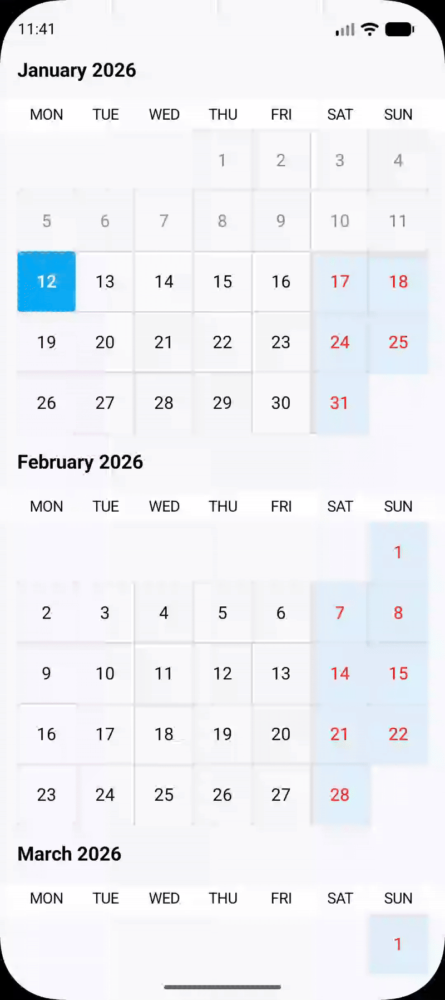

# Draggable DatePicker for Android 📅

A **modern, lightweight, and fully customizable date range picker** for **Jetpack Compose**,
featuring **smooth drag-based date selection**—perfect for travel, booking, and scheduling apps.

Built with performance, flexibility, and Compose best practices in mind.

---

## ✨ Features

- **Draggable ranges:** drag either end of a range, across months, with auto-scroll at the edges.
- **Date rules:** set minimum and maximum dates, block individual dates, and limit range length.
- **Two selection modes:** pick a range or a single date.
- **Two layouts:** scroll months vertically or page through them horizontally.
- **Ready-made containers:** use a dialog or bottom sheet with shortcuts such as "Next 7 days".
- **Tags:** add text, pills and price labels to any day, or draw your own cells with `dayContent`.
- **Accessible:** screen readers get each day's date, status and tags, and can select it.
- **Localized:** month names, weekdays, numbers, week start and right-to-left layouts follow the locale.
- **Material 3 theming:** light, dark and dynamic color work by default.

---

## 📸 Preview

<p align="center">
  
</p>

## 📦 Installation

### 1️⃣ Add JitPack Repository

Add JitPack to your `settings.gradle.kts` file:

```kotlin
dependencyResolutionManagement {
    repositories {
        google()
        mavenCentral()
        maven { url = uri("https://jitpack.io") }
    }
}
```

### 2️⃣ Add Dependency

Add the library to your app-level `build.gradle.kts`:

```kotlin
compileOptions {
        // This allows DayOfWeek to work on API 21
        isCoreLibraryDesugaringEnabled = true
        //....
    }

dependencies {
    implementation("com.github.dev-rahuljangra:draggable-datepicker:<latest-version>")
    //This is for Java LocalDate.now() support in min Sdk 21
    coreLibraryDesugaring("com.android.tools:desugar_jdk_libs:2.1.5")
}

```

🔗 **Latest version:** [GitHub Repository](https://github.com/dev-rahuljangra/draggable-datepicker)

## 🛠️ Usage

Create a state with `rememberDraggableDateRangePickerState()` and pass it to the picker. Give the
picker a bounded height, such as `Modifier.fillMaxSize()`, because the months scroll inside it.

```kotlin
@Composable
fun MyDateSelectionScreen() {
    val state = rememberDraggableDateRangePickerState()

    DraggableDateRangePicker(
        state = state,
        modifier = Modifier.fillMaxSize(),
        onRangeChange = { start, end -> /* start and end are LocalDate? */ },
    )
}
```

Read the selection at any time with `state.selectedStartDate` and `state.selectedEndDate`. Users tap
to choose dates, then drag a selected date to change the range.

### Date rules

```kotlin
DraggableDateRangePicker(
    state = state,
    minDate = LocalDate.now(),          // Defaults to today. Use null to allow past dates.
    maxDate = LocalDate.now().plusYears(1),
    isDateSelectable = { it !in soldOutDates },
    allowUnselectableDatesInRange = false, // A drag stops before a blocked date.
    minRangeDays = 2,                   // Range lengths count both ends.
    maxRangeDays = 14,
)
```

To show past dates, also set `startYear`, which defaults to the current year.

### Selection mode and layout

```kotlin
DraggableDateRangePicker(
    state = state,
    selectionMode = DateSelectionMode.SINGLE,
    orientation = CalendarOrientation.HORIZONTAL,
    stickyWeekdayHeader = false,        // Show weekdays in each month instead.
    hapticsEnabled = false,
)
```

### Dialog and bottom sheet

Both show preset shortcuts with confirm and cancel buttons. They don't close themselves, so hide them
from your callbacks.

```kotlin
if (showPicker) {
    DraggableDateRangePickerBottomSheet( // Or DraggableDateRangePickerDialog
        onDismissRequest = { showPicker = false },
        onConfirm = { start, end ->
            showPicker = false
        },
    )
}
```

To change the shortcuts, pass your own list:

```kotlin
presets = listOf(DateRangePreset("Next weekend") { today -> nextWeekend(today) })
```

To customize the picker inside, create the state yourself and pass `pickerContent`, using that same
state.

### Scrolling

The picker opens on the selected month, or else the current month. Set `initialDisplayedMonth` to
choose another.

```kotlin
scope.launch { state.scrollToMonth(YearMonth.of(2027, 1)) }
```

### Tags

Tags are keyed by epoch day.

```kotlin
state.setTags(
    mapOf(
        date.toEpochDay() to listOf(CalendarTag("Holiday")),
        date.plusDays(1).toEpochDay() to listOf(CalendarTag.pill("Sale")),
        date.plusDays(2).toEpochDay() to listOf(CalendarTag.price("$120")),
    )
)
```

### Custom day cells

`dayContent` replaces the drawn number and tags. The selection background is still drawn behind it.
Don't add click handlers, because cells need those touches for selection.

```kotlin
DraggableDateRangePicker(
    state = state,
    dayContent = { cell ->
        Box(Modifier.fillMaxSize(), contentAlignment = Alignment.Center) {
            Text(cell.dayText, fontWeight = if (cell.isToday) FontWeight.Bold else null)
        }
    },
)
```

## 🎨 Customization

Colors and text styles follow `MaterialTheme` by default. Override any of them:

```kotlin
DraggableDateRangePicker(
    state = state,
    colors = CalendarDefaults.colors(selectedDateContainerColor = Color(0xFF00696B)),
    calendarTextStyles = CalendarDefaults.textStyles(
        monthTextStyles = TextStyle(fontSize = 20.sp),
    ),
    weekendDays = listOf(DayOfWeek.FRIDAY, DayOfWeek.SATURDAY),
    cellSize = 48.dp,
)
```

The locale comes from the device configuration. Set `locale` or `firstDayOfWeek` to override it. To
translate the screen reader text and dialog labels, override the `ddp_*` string resources in your app.

## 📖 API docs

Generate the HTML docs with `./gradlew :draggable-datepicker:dokkaGeneratePublicationHtml`. The output
is in `draggable-datepicker/build/dokka/html`.

## 🧩 Common Use Cases

- Flight and hotel booking

- Event scheduling

- Leave management

- Subscription period selection

- Custom calendar-based workflows

## ✍️ Author

**Rahul Jangra** Passionate Android Developer focused on creating beautiful and functional UI components.

- GitHub: [@dev-rahuljangra](https://github.com/dev-rahuljangra)
- LinkedIn: [Rahul Jangra](https://www.linkedin.com/in/dev-rahul-jangra3310/)

## 🤝 Contributing

Contributions are what make the open-source community such an amazing place to learn, inspire, and create. Any contributions you make are **greatly appreciated**.

1. Fork the Project
2. Create your Feature Branch (`git checkout -b feature/AmazingFeature`)
3. Commit your Changes (`git commit -m 'Add some AmazingFeature'`)
4. Push to the Branch (`git push origin feature/AmazingFeature`)
5. Open a Pull Request

---

## ⭐ Support the Project

If you find this library helpful, please consider giving it a **Star** on GitHub. It helps other developers find the project and keeps me motivated to add more features!

## 📄 License

```text
Copyright 2026 Rahul Jangra

Licensed under the Apache License, Version 2.0 (the "License");
you may not use this file except in compliance with the License.
You may obtain a copy of the License at

    http://www.apache.org/licenses/LICENSE-2.0

Unless required by applicable law or agreed to in writing, software
distributed under the License is distributed on an "AS IS" BASIS,
WITHOUT WARRANTIES OR CONDITIONS OF ANY KIND, either express or implied.
See the License for the specific language governing permissions and
limitations under the License.
```
